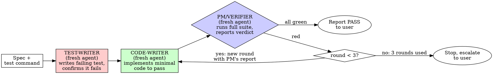

# TDD Pipeline (Role-Separated Test-Driven Development)

## Why role separation, not just discipline

Plain TDD asks one agent to write a failing test, watch it fail, then write minimal
code to pass it. That works, but it depends entirely on the same context staying
honest with itself across all three steps. The single most common way AI coding
agents break TDD is by quietly weakening the test instead of fixing the
implementation -- deleting an inconvenient assertion, loosening a comparison, or
mocking away the exact behavior that was supposed to be checked. An agent that
wrote both the test and the code has every incentive (and the context) to do this
without even framing it as cheating to itself.

Splitting the work across isolated subagents closes that loophole structurally
instead of relying on willpower:

- The **test-writer** never sees an implementation, so it can't tailor the test to
  one.
- The **code-writer** never sees the test-writer's reasoning or private notes,
  only the test file itself and the original spec -- so its only path to "done" is
  making the real test pass, not negotiating with itself about what the test
  "really meant."
- The **PM/verifier** is a fresh agent with no investment in either the test or
  the code, so its pass/fail report isn't colored by having just written the thing
  it's checking.

None of this works if a "subagent" secretly carries the whole conversation with
it. Use `subagent_type: general-purpose` (or another fresh-start type) for every
role below -- **never `fork`**, since a fork inherits your full conversation
context and would defeat the isolation this pattern exists to create.

## Before spawning anything

1. **Get the spec.** Make sure you have a clear, concrete description of the
   behavior to build -- acceptance criteria, not just a vague feature name. Ask
   the user if it's ambiguous. Every subagent prompt below needs this spec
   verbatim; they have no other way to know what "correct" means. If the user
   points you at a `specs/*.md` file, or asks you to write one first, use the
   `spec-writer` skill to produce it (don't invoke it automatically -- only if
   the user asks, or no usable spec exists yet and they'd rather have one
   written than dictate acceptance criteria inline).
2. **Find the test command and conventions.** Check `package.json` scripts,
   `CLAUDE.md`/`AGENTS.md`, and existing test files so you can tell each subagent
   the exact command to run (e.g. `pnpm test path/to/file.test.ts`) and which
   testing library/conventions to follow. Don't make subagents guess this.
3. **Decide scope.** One pipeline run should cover one coherent behavior (one
   feature or one bug fix). Large features should be broken into smaller slices,
   each run through its own pipeline -- a test-writer handed five unrelated
   behaviors at once will write a sprawling test file that's hard for anyone to
   verify cleanly.

## The pipeline

### Role 1: Test-writer

Spawn a fresh subagent. It must **not** write or even sketch implementation
code -- if it's tempted to, that's a sign the spec is unclear; have it ask
questions back through you instead.

Prompt it with, at minimum:
- The exact spec/acceptance criteria.
- The test framework, file location convention, and command to run a single test
  file.
- Instruction to write one or more minimal, real-behavior tests (no testing
  mocks unless a dependency makes that unavoidable) that will fail until the
  feature exists.
- Instruction to **run the test itself** and confirm it fails for the right
  reason -- missing behavior, not a typo or setup error -- and to fix the test
  and re-run if it errors instead of failing cleanly.
- Instruction to report back: the test file path(s), the exact failing output,
  and a one-line explanation of why it fails.

Do not proceed until you have that failing-output evidence in hand. A test-writer
that reports success without ever running the test hasn't done the job --
send it back to actually run it.

### Role 2: Code-writer

Spawn a **new** fresh subagent -- don't reuse the test-writer's agent, and don't
let it see the test-writer's scratch reasoning, only the artifact (the test file)
and the spec.

Prompt it with:
- The original spec (so it doesn't over-fit to only what the test happens to
  check, per your earlier call to give code-writer spec + test rather than test
  alone).
- The full contents (or exact path) of the failing test file(s), plus the
  failure output the test-writer captured.
- An explicit instruction **not to edit the test file(s)**. If it believes a test
  is wrong, it must say so in its report instead of changing it.
- Instruction to write the minimal code that makes the test(s) pass -- no
  speculative options, config flags, or unrelated refactors.
- Instruction to report back a diff/summary of what it changed.

On retry rounds (see below), also give it the PM's failure report from the
previous round instead of having it guess what's still wrong.

### Role 3: PM / verifier

Spawn another fresh subagent. Its only job is to run things and report facts --
it doesn't need to read the code or judge design quality.

Prompt it with:
- The exact command to run the **full** test suite (not just the new test file --
  a regression elsewhere is still a failure).
- The path(s) to the test file(s) the test-writer created.
- Instruction to run the suite, then report verbatim: which tests passed, which
  failed, and the exact failure output for any that failed.
- Instruction to check that the test file(s) still contain the same assertions
  the test-writer wrote (a quick diff/read-back, not a judgment call) and flag it
  plainly if a test was edited, weakened, or deleted -- since the code-writer was
  told not to touch them, any change there is itself a signal something went
  wrong, independent of pass/fail.

The PM's report is authoritative. Don't let a code-writer's "I believe this
passes now" substitute for the PM actually running it.

## The fix loop

If the PM reports failures, start a new round: spawn a **new** code-writer
subagent (fresh instance, not a continuation) with the spec, the test file, and
the PM's exact failure report from this round. Then spawn a new PM to re-verify.

Cap this at **3 rounds total**. If round 3's PM still reports failures, stop --
don't spawn a round 4. Report to the user: the spec, the test file, all three
rounds' PM reports, and your own assessment of whether the test or the approach
looks like the actual problem. Three failed rounds usually means the test is
wrong, the spec was ambiguous, or the approach needs rethinking -- not that a
fourth attempt will get lucky.

## After a PASS

Classic TDD includes a refactor step once green, and it's worth doing here too,
but keep it bounded so it can't turn into its own unbounded loop:

1. Optionally spawn one more fresh code-writer to clean up (remove duplication,
   improve names) with instructions to touch only implementation, never tests,
   and to keep behavior identical.
2. Spawn one more PM to re-verify.
3. If that PM reports failures, don't retry the refactor -- revert to the code
   from the last confirmed-green round and report that the refactor was skipped.

Then summarize the whole run for the user: what was built, the test file
path(s), how many rounds it took, and the final PM verdict.

## Common failure modes to watch for as orchestrator

| Symptom | What's actually happening |
|---|---|
| Test-writer reports a failing test but never shows you run output | It didn't actually run it. Send it back. |
| Code-writer's diff touches the test file | It was told not to. Reject the round, respawn code-writer without merging that change, remind it of the constraint. |
| PM's report is vague ("looks good") instead of exact test names/output | PM didn't actually run the suite, or is summarizing instead of reporting. Send it back for verbatim output. |
| Same failure repeats verbatim across rounds | Code-writer isn't receiving the previous PM report properly, or the test itself may be wrong -- worth pausing to check before burning the remaining rounds. |
| You're tempted to skip spawning a real PM and just eyeball the code-writer's self-report | Don't. That collapses the whole point of this pattern back into single-agent TDD. |
